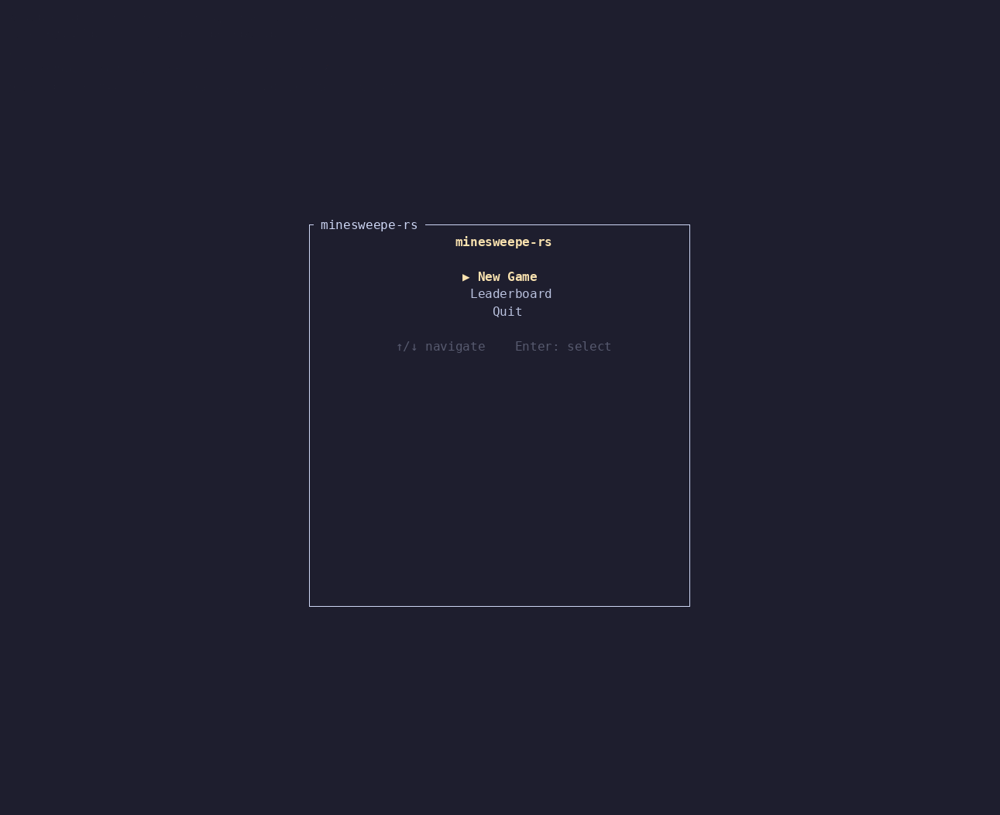

# minesweepe-rs

rust minesweeper. minesweeper in rust.

- every board is guaranteed solvable without guessing — a solvable layout is pre-generated in the background as you hover before your first click
- built-in hint system (`?`) highlights cells deducible from the current board state
- leaderboard tracking for beginner, intermediate, and expert
- mouse and keyboard support



## install

### cargo

```shell
cargo install minesweepe-rs
```

### nix run

```shell
nix run github:meihapps/minesweepe-rs
```

### add to nix profile

```shell
nix profile install github:meihapps/minesweepe-rs
```

### flake / home manager

1. add to flake inputs

```nix
inputs = {
    nixpkgs.url = "github:NixOS/nixpkgs/nixos-unstable";
    minesweepe-rs.url = "github:meihapps/minesweepe-rs";
};
```

2. Add to system packages and rebuild

```nix
{config, pkgs, inputs, ... }: {
    environment.systemPackages = [
        inputs.minesweepe-rs.packages.${pkgs.system}.default
    ];
}
```

## controls

| action | keyboard | mouse |
|--------|----------|-------|
| move cursor | `hjkl` / arrow keys | — |
| reveal | `enter` / `space` | left-click |
| flag | `f` | right-click |
| reveal all neighbours | `enter` / `space` on revealed cell | left-click revealed cell |
| flag all neighbours | `f` on revealed cell | right-click revealed cell |
| hint | `?` | — |
| menu | `esc` | — |
| quit | `q` | — |

flag cycles: hidden → flagged → question → hidden.

## leaderboard

times are recorded for beginner, intermediate, and expert. games where hints were used are not ranked.

## hints

press `?` during a game to request a hint. the solver will highlight cells that can be deduced safe or as mines from the current board state. using a hint disqualifies the run from the leaderboard.
